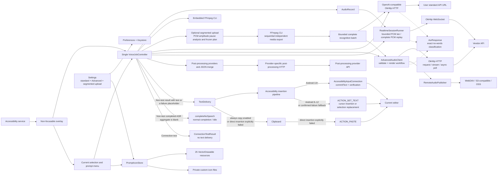
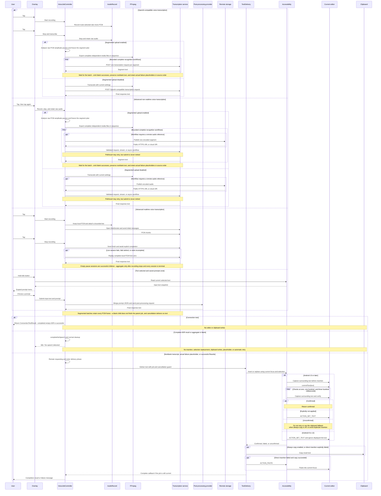
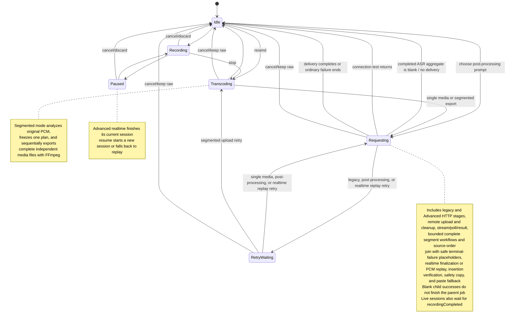
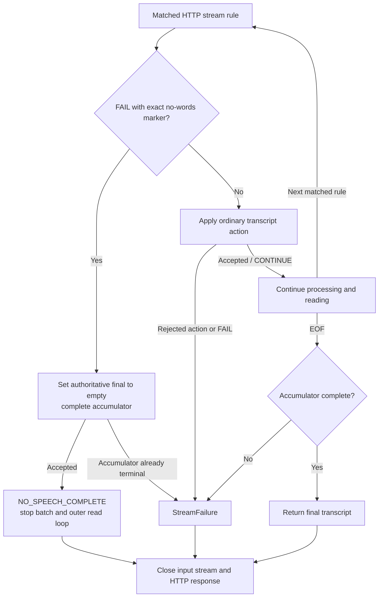

# AGENTS.md

Dictate is an Android speech transcription and selected-text post-processing tool operated through an accessibility floating button that does not steal focus. Audio or selected text is sent directly to the service specified by the user, with one task executed at a time. Transcription and post-processing share the same write rule: if there is no selection when writing, the text is inserted at the current cursor position; if there is an editable selection, that portion of text is replaced.

## Downloads

| Platform | Download | SHA-256 |
|---|---|---|
| arm64-v8a | [arm64-v8a](https://github.com/Joey-Kot/Dictate/releases/download/Latest/Dictate-latest-arm64-v8a.apk) | [sha256](https://github.com/Joey-Kot/Dictate/releases/download/Latest/Dictate-latest-arm64-v8a.apk.sha256) |

## Introduction to the Audio Transcription Feature

- **Audio transcription**: Works outside the IME through a floating button that does not take focus. Supports pausing, canceling, and retranscribing the most recent recording, including with the screen off.
- **Text rewriting**: Configure prompts, providers, models, and parameters. After selecting text, long-press the floating button to choose and invoke a rewrite action.
- **Custom APIs**: Configure standard OpenAI-compatible audio APIs and Rewrite APIs from different providers, together with models, prompts, and additional request parameters.
- **Advanced Custom Audio API Provider**: Generate and validate declarative ASR Provider workflows from separate user requirements and vendor documentation. Provides typed controls, conditional visibility, single-select and multi-select controls, and supports one-shot requests, streamed responses, asynchronous polling, and real-time WebSocket transcription.
- **Segmented upload**: Optionally split long non-realtime ASR work into independent local batches. It uses raw PCM amplitude pauses without removing silence, exports complete media files sequentially through FFmpeg, and bounds concurrent recognition workflows. It supports standard OpenAI-compatible transcription and Advanced non-realtime workflows; realtime and Rewrite are excluded.
- **Visible ASR failures**: After retries are exhausted, terminal ASR request failures insert a concise, redacted placeholder. Valid completed responses with an empty, whitespace-only, or `null` transcript finish normally without output, retries, or placeholders; the exact HTTP 400 `ASR_RESPONSE_HAVE_NO_WORDS` recognition response also means no speech. Segmented batches omit empty transcripts and retain successful sibling text and actual failure placeholders in source order. Cancellation, configuration, and local-media failures remain ordinary errors.
- **Automatic insertion**: Transcription and rewrite results are inserted at the active cursor or replace the current editable selection. A clipboard copy is retained by default; when that option is disabled, the clipboard is used only as a fallback after a confirmed write failure.
- **Audio processing**: Choose recording and output formats; FFmpeg is bundled, with no separate installation required.
- **Local concurrent segmented uploads**: Based on audio-amplitude silence analysis, uses pauses as preferred breakpoints while preserving the complete audio timeline, exports the audio as independent media chunks, and submits them to the ASR API with limited concurrency.
- **Task and configuration security**: Transcoding, network requests, and retries can all be canceled. API keys, workflows, and remote-storage credentials are encrypted with Android Keystore, with support for redacted diagnostics, live endpoint testing, and validated JSON import and export.

### Introduction to the selected-text processing feature

- Select text, hold the idle floating button, and choose a prompt from the menu to process the selection. With no selected text or no saved prompts, holding the button resends the previous recording.
- Configure Provider, Base URL, API Key, and Model independently under **Rewrite API Settings**. Dictate has 25 built-in Rewrite Providers; their request formats, endpoint completion rules, and credentials are listed in [Post-processing configuration](#post-processing-configuration).
- Prompts default to **Same as main provider**, inheriting all Rewrite API settings. Each prompt can instead use its own Provider, Base URL, API Key, and Model, with a Test connection button that works before saving.
- Each prompt has an icon, title, instructions, and its own additional JSON parameters. Saved prompts can be edited, deleted, and reordered; choose from 25 built-in two-tone blue icons or import SVG, PNG, or JPG.
- Per-prompt JSON overrides request fields, including the selected API's `model`. Nested objects merge recursively, arrays are replaced as a whole, other values overwrite existing values, and object fields explicitly set to `null` are removed from the request.
- Use your own prompts to polish, rewrite, translate, or summarize existing text or a completed transcription, without starting another recording.
- Post-processing preserves the previous recording. It shares transcription's processing state, double-tap cancellation, automatic retries, and write behavior: insert at the current cursor, or replace the editable selection present when writing.

### Floating button gestures

| State | Tap | Hold | Fast double tap |
|---|---|---|---|
| Idle | Record | Open the menu if text is selected and saved prompts exist; otherwise resend the previous recording | No action |
| Recording | Stop and transcribe | Pause | Cancel and discard |
| Paused | No action | Resume | Cancel and discard |
| Processing | No action | No action | Cancel the current task and retain existing audio |

Gesture precedence is `drag > hold > double tap > tap`. A hold is confirmed on release, so movement beyond the system touch threshold at any point before release always becomes a drag. A short tap is confirmed only after the configured double-tap window, so a fast double tap always has one unambiguous outcome.

The prompt menu expands smoothly from the button into a rounded, translucent, vertically scrolling panel. Tapping outside collapses it to the idle microphone button; choosing a prompt collapses it and enters processing. With no saved prompts, a hold resends the previous recording even when text is selected.

## Architecture



The no-speech and connection-test nodes are controller branches, not additional job states. Child segment results return to their parent batch before the controller decides whether the complete result needs delivery. The shared no-words classifier is used by ASR clients; Rewrite keeps its own response validation.

### Implementation map

Paths below are relative to `app/src/main/java/com/joeykot/dictate/` unless a resource path is shown.

| Module | Responsibility relevant to empty recognition and prompt icons |
|---|---|
| `network/AsrResponse.kt` | Shared exact no-words code matching, with an HTTP-400-only wrapper. |
| `network/TranscriptionClient.kt` | Legacy HTTP response validation; top-level `text` must exist and be a string or explicit `null`. |
| `network/AppHttpClient.kt`, `network/dns/` | Shared application DNS policy, Android Private DNS/network monitoring, asynchronous backup preparation, and recovery on the first system DNS failure. |
| `advanced_audio/JsonPath.kt` | Bounded scalar extraction; opt-in `nullAsEmpty` for transcript fields only. |
| `advanced_audio/TranscriptAccumulator.kt` | Text assembly and `OPEN / COMPLETE / FAILED` lifecycle; `isTranscriptText` identifies the four nullable text actions. |
| `advanced_audio/AdvancedAudioClient.kt` | Request, HTTP stream, and async-poll execution; no-words termination, retries, cancellation checks, and remote cleanup. |
| `advanced_audio/realtime/RealtimeSessionRunner.kt` | WebSocket rules and completion; retains the guard against completing before live PCM has ended. |
| `advanced_audio/WorkflowSchemaDescription.kt` | Documents nullable transcript semantics for workflow generation without relaxing control-field extraction. |
| `job/VoiceJobController.kt` | Aggregate child results, distinguish empty ASR success from failure, route whole-job completion or text delivery, and notify DNS maintenance once per completed voice job. |
| `model/PostProcessingConfig.kt`, `settings/PostProcessingSettingsCodec.kt` | Prompt icon ID, optional custom filename, object defaults, and JSON persistence. |
| `util/PromptIconStore.kt`, `app/src/main/res/drawable/prompt_icon_*.xml` | Ordered built-in icon catalogue, Android vector loading, custom import, and display fallback. |
| `ui/PostProcessingSettingsView.kt`, `overlay/PostProcessingMenuView.kt` | Horizontal icon picker and menu presentation; the editor owns pending imports and persists prompts independently. |
| `settings/PromptIconAssets.kt`, `settings/SettingsRepository.kt` | Referenced custom-image export/import and cleanup after successful settings persistence. |

## Request Sequence



Post-processing captures selected text before opening the menu as its input. Both task types resolve the output target at write time; neither binds output to the field or selection present when the request began. Moving the cursor, changing selection, or switching editors while waiting changes where the result is delivered. Both use the same verification and clipboard fallback.

## Job state machine



Internal task states remain idle, recording, paused, transcoding, requesting, and retry waiting. Advanced HTTP stages reuse requesting; their phase-level retries never enter retry waiting or resubmit an async task. Realtime PCM replay retries use retry waiting and restart from byte zero. The menu is an idle presentation state and starts no request. Post-processing enters requesting directly, without recording or transcoding; success, failure, and cancellation do not replace the previous recording.

## ASR result contracts

An empty recognition is a successful result only after the response satisfies its protocol's completion rules. Missing required final-text fields, invalid responses, and streams ending before completion remain errors. An Advanced request using `final_text = plain_body` may legitimately return an empty body when its configured HTTP status and extraction rules accept it. Rewrite does not use the ASR no-speech or failure-placeholder branches.

### Text extraction and no-words classification

| Context | Accepted empty result and retained validation |
|---|---|
| Legacy HTTP success | Top-level `text` must exist. Strings are returned unchanged, including empty/whitespace-only strings; JSON `null` becomes `""`. Missing fields, other types, and malformed JSON remain errors. |
| Advanced request / async final text | `final_text` JSONPath enables `nullAsEmpty`. Existing string, number, and boolean scalar extraction is retained; missing/multiple matches, arrays, objects, and invalid JSON remain errors. Other extractor types retain their existing rules. |
| HTTP / WebSocket text rules | Only `append_delta`, `replace_partial`, `commit_segment`, and `set_final_text` allow selected JSON `null` as `""`. A text action alone does not complete recognition. |
| Captures and control rules | `nullAsEmpty` remains disabled for captures, polling conditions, `complete`, `fail`, and other non-text rules. An absent path in a mixed event stream skips that rule; it does not create a successful empty result. |

Empty text actions preserve their normal accumulator meaning: appending `""` adds nothing; replacing partial text with `""` retains committed text; committing `""` clears partial text; setting final text to `""` overrides all earlier accumulated text. Do not trim individual deltas or nonblank results, since provider-supplied spacing may be significant.

`AsrResponse.kt` recognizes only the exact string `ASR_RESPONSE_HAVE_NO_WORDS`. JSON-body matching accepts a root object's `code`, `message`, `info`, or `detail`, a string-valued `error`, or those same four fields inside an `error` object. It does not search arbitrary descendants, match substrings, or treat the transcript's `text` field as an error code.

| Recognition path | When the marker means successful empty recognition |
|---|---|
| Legacy HTTP | Status is exactly 400 and the body matches the shared classifier; returns empty success with the original status and elapsed time. |
| Advanced request / async submit, poll request, result steps | HTTP 400 plus the exact marker raises internal `NoSpeechResponse`, ending the workflow before captures/final-text extraction or later stages. No automatic retry is scheduled. |
| Advanced HTTP stream response | HTTP 400 plus the exact marker returns `CompletedRequest("", status)` before stream decoding, closes the response, and does not retry. This response-level check is separate from event-rule matching. |
| Async prepare | `allowNoSpeech = false`; preparation/authentication responses do not use the recognition shortcut. |
| Poll response not already handled by the HTTP 400 shortcut | For an accepted status, only after workflow conditions select `PollState.FAILURE` is the body checked for no-words. A pending HTTP 200 response containing the marker stays pending; unrelated failures remain failures. The HTTP 400 shortcut takes precedence even when 400 is explicitly accepted by the workflow. |
| HTTP stream / WebSocket event | A `fail` rule must first match its `event`, `path`, and `equals` constraints. Only then can the extracted value or event JSON carry the marker. The matched event sets authoritative final text to `""` and completes recognition. |

Other HTTP errors, including 401, 403, 408, 429, and 5xx, do not become successful merely because their body contains the marker. These constraints apply before the controller's blank-text check; that check cannot turn a malformed or incomplete response into success.

### HTTP stream termination

`TranscriptAccumulator` still has only `OPEN`, `COMPLETE`, and `FAILED` states. `StreamRuleResult.NO_SPEECH_COMPLETE` is a separate HTTP rule-execution outcome, not another accumulator or job state. Ordinary `complete` returns `CONTINUE` to the reader so subsequent matched actions are still validated through EOF. A matched no-words failure returns `NO_SPEECH_COMPLETE`, ending both the current decoded batch and the outer read loop. All six `push`/`finish` call sites for SSE, NDJSON, and JSON_CHUNKS propagate this result.



The no-words accumulator operations use the same `TranscriptAccumulatorException` to `StreamFailure` conversion as ordinary actions. Consequently, no-words after an ordinary completion cannot erase an already invalid event sequence. Early success still runs input-stream `use` and response `finally` cleanup; it does not wait for the server to close a long-lived connection. Framing errors raised before a decoded event is available remain errors.

WebSocket handling exits its receive loop when the accumulator completes. Empty completion itself does not trigger replay, but `LiveCompletedBeforeSourceEnd` still protects unfinished live PCM: a server completing before the live source ends causes the existing full-recording replay path after recording stops.

### Aggregation, delivery, and cleanup

Legacy and Advanced segmented batches omit only successful items whose entire text is blank. They preserve every nonblank result exactly, add no separators, and keep actual terminal request-failure placeholders at their original source positions. A blank child remains a successful child; the parent waits for its batch before classifying the complete aggregate. Connection tests report actual failures directly instead of inserting placeholders.

Pause-delimited live realtime sessions follow the same text-preservation rule but retain their own lifecycle. Each successful empty session becomes terminal normally. The controller waits for `recordingCompleted` and every session's terminal state before joining nonblank text. An actual live failure still cancels sibling sessions, discards their partial live results, and triggers replay of complete local PCM.

Whole-request or aggregate ASR success with `text.isBlank()` calls `completeNoSpeech()`, which reuses `completeJob()`. Normal jobs return to Idle with localized `No speech detected`, bypassing `TextDelivery`, selection replacement, insertion, clipboard copying/pasting, placeholders, and automatic retries. Connection tests return `success = true` with available status/elapsed metadata; an HTTP 400 no-words response can therefore be a successful test carrying status 400.

A valid original recording is retained once recording finishes, and empty recognition success does not delete it; it remains available for manual resend. Non-realtime requests start after promotion, while live realtime recognition can already be running during capture. Encoded temporary output and batch export directories are cleaned up normally; connection tests also delete their own temporary recording. A saved segmented-upload plan remains associated with the retained recording for subsequent resend. Local `SegmentedUploadPreparationResult.NoSpeech` is a separate pre-request outcome: it still uses `handleSegmentedNoSpeech()`, reports an unsuccessful connection test, and follows the existing local no-speech message path for normal jobs.

Cancellation and late-result guards remain active. Controller callbacks must match the current job ID (and live recording instance where applicable); canceled results cannot reach delivery. Started segmented children are allowed to drain after cancellation so their remote cleanup can finish. Advanced HTTP success checks cancellation again before returning; remote objects are cleaned in `finally`, honoring successful-upload retention for empty success and forcing deletion after failure/cancellation. Cleanup failure does not replace the recognition outcome.

## DNS fallback and network diagnostics

All application HTTP and WebSocket entry points use `AppHttpClient` / `AppDns`, including standard ASR, Rewrite, Advanced workflows, remote storage, and realtime handshakes. Standard ASR and Rewrite now use OkHttp while retaining their response contracts, fixed-length uploads, cancellation scopes, 15-second connect / 30-second write / 60-second read limits, and explicit controller retries. Their shared client permits connection recovery before sending, so an unreachable first DNS address does not suppress later usable addresses. Both request bodies are one-shot, preventing automatic POST replay after sending or HTTP 408/503 responses. Advanced HTTP (including async submit) and WebSocket clients retain their stricter disabled automatic-retry policy; all application clients disable redirects. DNS recovery finishes before sending the application request and does not resubmit a POST.

`FallbackDns.prepare()` asynchronously prepares a backup during application initialization and after relevant network/DNS configuration changes. Preparation does not wait for network I/O or change the primary resolver: application lookups continue through `Dns.SYSTEM` until the first eligible lookup fails with `UnknownHostException`. That same lookup immediately uses the prepared DoH provider and activates process-local fallback after successful recovery. If preparation is still running, the failed lookup awaits that shared batch; if no batch or prepared provider exists, it starts one without a failure threshold. Successful recovery continues the original application request, without a controller retry or failure placeholder. Cancellation, HTTP status errors, and TCP/TLS timeouts do not activate fallback. There are no failure counters or timer-driven probes.

Every 20 completed voice jobs, `VoiceJobController.completeJob()` notifies `AppDns` to schedule background maintenance on the resolver coordinator. This process-memory counter increments once for the entire job, including manual resend, successful empty recognition, and delivered terminal-failure placeholders. Individual uploaded segments, live pause sessions, and automatic retries do not increment it; canceled jobs, connection tests, Rewrite, and jobs ending through ordinary/local failure do not count. The count resets every 20 completions and on process restart. Maintenance keeps the existing prepared/active provider usable while probing, replaces it atomically only on success, and retains it on probe failure. It preserves system-first versus already-activated fallback mode, honors Private DNS/unknown-network suppression and cooldown, shares a pending batch, and never overlaps another resolver race. No network-state reads or network I/O run on the completing job's thread. Network/Private DNS changes still invalidate old choices and discard stale maintenance results.

On Android 9+, both preparation and fallback are disabled when Private DNS is active, a strict server name is present, or the readable AOSP `private_dns_mode` / `private_dns_default_mode` setting specifies a provider or an unknown mode. Reading the configured mode also protects strict Private DNS when a VPN omits its server name from `LinkProperties`. Inactive automatic mode may recover through DoH; Android 8 does not call newer Private DNS APIs. Missing network/link properties or inaccessible policy state preserve system DNS. Default-network and Private DNS observers, plus synchronous checks, clear preparation/activation and cancel pending probes on relevant changes, then prepare again when policy permits. Network, DNS servers, search domains, proxy, and usable IP-family changes reset the state; duplicate callbacks share existing preparation instead of launching repeated batches.

Probing uses six workers, shuffled candidates, a six-second batch deadline, and only `example.com`. The first valid positive response with public addresses wins; other probes are canceled. Only the selected service receives actual API hostnames. Single-label names, IP literals, local/reserved suffixes, and configured network search domains always use system DNS. An unhealthy prepared/active provider is excluded for 30 seconds; the same lookup immediately joins an existing probe or selects a replacement, with at most two sequential provider attempts per lookup. A late probe cannot reinstall a provider another lookup has just rejected. Only a failed probe batch imposes a 30-second global cooldown. Network changes clear provider exclusions; expired exclusions allow recovered providers to rejoin later probes. Authoritative NXDOMAIN/no-address results terminate the lookup without selecting another provider. Selection is process memory only and disappears after process restart; IP answers are not pinned or cached by the app. Each new lookup fetches current A/AAAA records. IPv6-only links prefer IPv6 for bootstrap and returned addresses.

DoH uses the official `okhttp-dnsoverhttps:4.12.0` module with POST DNS wire messages. A separate client pins only each resolver's bootstrap addresses, retains HTTPS hostnames/SNI and normal certificate verification, honors the platform proxy selector, and never calls `AppDns` recursively. Bootstrap DNS instances are shared per provider, preferred IP family, and network generation so consecutive lookups can reuse established connections; they never capture a query's cancellation state. A hostname-based HTTP proxy still resolves through system DNS; DoH cannot bootstrap through an unreachable proxy. Resolver DNS requests may retry alternate bootstrap addresses within a 2.5-second call deadline. HTTP status, DNS media type, bounded decoded body (65,535 bytes), response ID/flags/question count and DNS RCODE are checked before the library decodes answers. HTTP 200 alone is insufficient. Calls for both address families are canceled when their lookup is canceled or policy changes. Network reset clears the bootstrap-instance cache and evicts idle DoH connections.

HTTP listeners bind cancellation to the synchronous DNS call. OkHttp removes `EventListener` for WebSocket handshakes, so `OkHttpRealtimeWebSocketFactory` explicitly scopes its DNS delegate with the job token and handshake cancellation flag. User cancellation and handshake deadlines stop waiting for preparation and cancel request-owned probes/lookups before any WebSocket opens. Process-level background preparation continues independently when a waiting request is canceled; network or Private DNS changes cancel that background work as well.

The built-in catalogue contains 16 independent providers, preferring unfiltered variants when available. Filtering and legal policies remain those of the selected provider. Keep endpoints/bootstrap literals and their official sources together in `DohProviderCatalog.kt`; do not add discontinued services, account-bound endpoints, or unverified community mirrors.

| Provider | Official endpoint/configuration source |
|---|---|
| Alibaba AliDNS (China) | [AliDNS](https://www.alidns.com/) |
| Tencent DNSPod (China) | [Public DNS](https://www.dnspod.cn/products/publicdns), [current domain access notice](https://docs.dnspod.cn/notices/mian-fei-ban-dot-dohbu-zai-gong-kai-ipjie-ru-de-gong-gao/) |
| 360 (China) | [Public DNS configuration](https://sdns.360.net/dnsPublic.html) |
| Cloudflare (US) | [Resolver addresses](https://developers.cloudflare.com/1.1.1.1/infrastructure/network-operators/) |
| Google (US) | [Public DNS DoH](https://developers.google.com/speed/public-dns/docs/doh) |
| Cisco OpenDNS (US) | [Encrypted resolver endpoints](https://umbrella.cisco.com/blog/enhancing-support-dns-encryption-with-dns-over-https) |
| Quad9 (Switzerland) | [Service variants](https://docs.quad9.net/services/) |
| AdGuard (Cyprus) | [Unfiltered service](https://adguard-dns.io/kb/general/dns-providers/) |
| Control D (Canada) | [Free DNS](https://docs.controld.com/docs/free-dns) |
| CIRA Canadian Shield (Canada) | [Private service addresses](https://www.cira.ca/en/canadian-shield/configure/summary-cira-canadian-shield-dns-resolver-addresses/) |
| Mullvad (Sweden) | [Encrypted DNS](https://mullvad.net/en/help/dns-over-https-and-dns-over-tls) |
| DNS.SB | [DoH endpoints](https://dns.sb/doh/) |
| CZ.NIC (Czech Republic) | [ODVR configuration](https://www.nic.cz/odvr/) |
| RESTENA (Luxembourg) | [Authenticated resolver endpoints](https://restena.lu/en/document/404-authenticate-servers-community-dns-resolvers) |
| DNS4EU (EU) | [Public unfiltered service](https://www.joindns4.eu/for-public) |
| UncensoredDNS (Denmark) | [Service operator](https://blog.uncensoreddns.org/) |

DNS diagnostics use the `dns` tag for reset decisions, batch start reasons (`preparation`, `dns_failure`, `provider_failure`, or `transcription_count`), usage-refresh requests/skips, backup readiness (`fallback_ready`), actual activation (`fallback_activated`), provider ID/timing, unhealthy selection, failure retention, and successful fallback lookup address counts. Do not include hostnames, URLs, DNS answers, or raw errors in these entries.

Advanced HTTP recognition uses per-invocation `AdvancedAudioDiagnostics` and a per-call `HttpCallDiagnostics` OkHttp listener. Controller callbacks add job and segment IDs; stage, attempt, and request IDs remain scoped to one workflow, including concurrent segmented uploads. Requests, streams, and polling log status/timing, DNS/connect/TLS/upload/download events, pooled connections, retry decisions, typed failure causes, and a terminal workflow outcome before any failure-placeholder delivery. HTTP completion and successful recognition are distinct events. The callback must never change request/retry/cancellation behavior. Do not log rendered URLs, headers, request/response contents, transcript text, or raw exception messages. Exception class names used for diagnosis are retained by R8 rules.

`Diagnostics` restores retained disk entries on construction. The panel defaults to the retained 2,000-entry memory window; the disk log rotates at 512 KiB. Logging remains bounded, and clear removes both the in-memory and persisted history.

Opening the Diagnostics panel copies the same nonblank snapshot to the clipboard and shows a localized success/failure message. Collapsing the panel or opening an empty log leaves the clipboard unchanged.

## Requirements

- Android 8.0+ (`minSdk 26`) on an `arm64-v8a` device.
- Enabled Dictate accessibility service; recording additionally needs microphone permission.
- Transcription needs either an OpenAI-compatible `POST /v1/audio/transcriptions` endpoint, Base URL, API Key, and model, or an enabled validated Advanced Audio API workflow with its declared values and secrets.
- Post-processing needs valid Provider, Base URL, API Key, and model settings, either shared or configured per prompt, and at least one saved prompt.

Selection reading and text delivery depend on the target application's accessibility support. Read-only selections can supply post-processing input; password fields, protected screens, and custom controls may hide selections or reject writing. The existing clipboard fallback handles unavailable editable focus. Dictate does not contain per-app compatibility logic.

On Android 13 and newer, when accessibility nodes do not expose selected text, Dictate also queries the current editor's input connection in the background before choosing between the prompt menu and resending audio. This does not change the clipboard. Results are discarded if the editor, selection, or active task changes during the read.

## Build from source

Use a current JDK 17 security update (17.0.21 or newer), Android SDK Platform 35, Build Tools 36.0.0, and NDK `27.2.12479018`.

```bash
export JAVA_HOME=/path/to/jdk-17
export ANDROID_HOME=/path/to/android-sdk
export ANDROID_NDK_HOME="$ANDROID_HOME/ndk/27.2.12479018"
export GRADLE_USER_HOME=/tmp/gradle-user-home
python3 scripts/harden-jdk-certificates.py "$JAVA_HOME"
./gradlew :app:assembleDebug
```

`assembleDebug` automatically runs `scripts/build-android-ffmpeg.sh` when its arm64 FFmpeg binary is missing or the script has changed, then packages the result at `app/src/main/jniLibs/arm64-v8a/libffmpeg.so`. This requires an installed Android NDK exposed through `ANDROID_NDK_HOME` or `ANDROID_NDK_ROOT`; the generated binary is reused by unchanged Debug builds. The script remains available for an explicit native-only rebuild. Signed releases additionally use `ANDROID_KEYSTORE_PATH`, `ANDROID_KEYSTORE_PASSWORD`, `ANDROID_KEY_ALIAS`, and `ANDROID_KEY_PASSWORD`.

Release builds enable R8 code shrinking, optimization, obfuscation, and resource shrinking. CI archives `mapping.txt` as a workflow artifact for recovering original crash stack traces. Debug builds remain unminified.

The build uses AGP 9.4.1, Gradle 9.8.1, and AGP built-in Kotlin overridden to 2.4.21. Buildscript-only constraints upgrade Bouncy Castle to 1.85, Commons Lang to 3.18.0, jose4j to 0.9.6, and JDOM to 2.0.6.1; these overrides do not add APK runtime dependencies. Before starting Gradle, `scripts/harden-jdk-certificates.py` applies the pinned [eMudhra certificate blocklist](https://docs.azul.com/core/emudhra-workaround) to the build JDK while preserving existing blocks; restart any existing Java/Gradle processes afterward. CI applies it immediately after setting up Java.

The native build requires Linux, `make`, `pkg-config`, `curl`, `tar`, gzip, and XZ support. The script verifies the FFmpeg `9.0.2`, Opus `1.5.2`, LAME `3.100`, libogg `1.3.5`, libvorbis `1.3.7`, OpenCORE AMR `0.1.6`, VisualOn AMR-WB `0.1.3`, and Speex `1.2.1` source archives by SHA-256. FFmpeg uses the unmodified `https://www.ffmpeg.org/releases/ffmpeg-9.0.2.tar.gz` release archive. It builds only AArch64, checks every required encoder/muxer/filter, rejects input demuxers other than `pcm_s16le`, and verifies the resulting Android PIE executable's 16 KiB load alignment. This FFmpeg build uses `--enable-gpl --enable-version3`; dependency licenses and checksums are recorded in [THIRD_PARTY_LICENSES.md](THIRD_PARTY_LICENSES.md).

After the native build, audio integration tests can run the packaged Android binary under QEMU with the Android 8 runtime. They require `qemu-user` (`qemu-aarch64`), `e2fsprogs` (`debugfs`), Python 3, and a host C compiler. The script extracts the runtime without mounting the SDK image and builds an independent FFmpeg 9.0.2 decoder/probe from the downloaded sources. Its container demuxers validate generated test output and are not packaged in the APK.

```bash
"$ANDROID_HOME/cmdline-tools/latest/bin/sdkmanager" 'system-images;android-26;default;arm64-v8a'
DICTATE_AUDIO_FULL=1 ./scripts/test-android-audio.sh
./gradlew :app:testDebugUnitTest :app:lintDebug
```

The full audio matrix checks every offered codec/container, sample-rate preset, and selectable bit depth, using default/minimum/maximum bitrates and every AMR/Speex mode. It checks decoded audio, stream metadata, raw PCM size/byte order, and exact mono duplication into two and six channels. CI runs this matrix before release packaging. QEMU validation does not replace microphone and device testing.

The packaged connectivity-test clip is a synthetic 16 kHz mono rendering of the word “test”, generated from Flite `2.2`'s `cmu_us_slt` voice. Its reproducible generation command is in `scripts/generate-connectivity-test-audio.sh`; provenance and the CMU notice are recorded in `THIRD_PARTY_LICENSES.md`.

GitHub release signing uses these repository secrets:

```text
ANDROID_KEYSTORE_BASE64
ANDROID_KEYSTORE_PASSWORD
ANDROID_KEY_ALIAS
ANDROID_KEY_PASSWORD
```

GitHub Actions is the default release path. Pushes to `main` and `dev`, plus manual dispatches with an optional ref, build a signed arm64 APK, generate the standard SHA-256 file, force-update the `Latest` tag, delete old Release assets, and upload only the current pair. One shared concurrency group prevents an older overlapping build from replacing a newer `Latest` publication.

### Regression coverage and validation record

Relevant tests live under `app/src/test/java/com/joeykot/dictate/`:

| Test file | Behavior covered |
|---|---|
| `network/dns/FallbackDnsTest.kt` | First-failure recovery, asynchronous preparation with system DNS retained as primary, pending-preparation sharing, configuration reset/repreparation, Private DNS suppression, local/search-domain isolation, request cancellation independent of background preparation, cooldown, and process reset. |
| `network/dns/FallbackDnsRecoveryTest.kt` | Same-lookup replacement of failed prepared/active providers, concurrent and maintenance-probe sharing, rejection of stale unhealthy winners, failed-batch cooldown and provider reentry, bounded target attempts, cancellation, and Private DNS changes during recovery. |
| `network/dns/DohUsageRefreshTest.kt` | Exact 20-completion threshold, asynchronous refresh with the active backup retained, atomic replacement, failed-refresh retention, batch sharing, system-primary preservation, Private DNS/unknown-network suppression, and stale results after a network change. |
| `network/dns/AndroidDnsNetworkStateTest.kt` | Active/strict/unknown Private DNS policy, VPN-hidden configuration, and Android 8 API compatibility. |
| `network/dns/DohTransportTest.kt`, `network/dns/DohHttpIntegrationTest.kt` | Fixed bootstrap with preserved Host, A/AAAA wire responses, HTTP-200 NXDOMAIN, invalid/bounded responses, cancellation of both in-flight queries, keep-alive connection reuse, network-reset isolation, and cancellation-independent cached bootstrap against local servers. |
| `network/dns/WebSocketDnsCancellationTest.kt` | Actual OkHttp WebSocket handshakes cancel pending resolver selection on job cancellation or handshake timeout despite disabled HTTP event listeners. |
| `network/AsrResponseTest.kt` | Exact marker and supported JSON locations; reject other HTTP statuses, prefixes/suffixes, wrong locations, and malformed bodies. |
| `network/PostProcessingClientTest.kt` | Includes Legacy ASR empty/whitespace/null success, HTTP 400 no-words, rejection of missing/malformed/wrong-type text, and standard ASR/Rewrite address recovery before one upload without replay after disconnect or HTTP 408/503, alongside existing Rewrite tests. |
| `advanced_audio/AdvancedAudioClientTest.kt` | Empty request/async results; no-words stops later stages without retry; prepare/authentication and pending-poll boundaries; three stream formats stop on no-words without another read, ignore decoded tail frames, close resources, and preserve ordinary-complete errors; cancellation before remote cleanup. |
| `advanced_audio/realtime/RealtimeSessionRunnerTest.kt` | Empty/null final text and matched no-words override partial text; incomplete or failed streams remain errors; live completion before source end remains rejected for replay. |
| `job/AdvancedAudioJobTest.kt` | Empty connection-test success, Legacy/Advanced all-empty and mixed segmented results, no delivery/clipboard change, empty realtime replay success, cancellation during request or retry, and whole-job DNS-maintenance counting with segment/retry deduplication and connection-test/Rewrite/cancellation exclusion. |
| `util/PromptIconStoreTest.kt` | Custom SVG/PNG/JPG import, size limits, decode-failure cleanup, referenced-file retention, and fallback. |
| `ui/PromptIconImportLifecycleTest.kt` | Editor recreation, pending import restart, deletion, and isolation/cleanup of late import results. |
| `settings/SettingsRepositoryPostProcessingTest.kt` | Custom icon export/import, fresh filenames, read-only import preview, missing assets, and unsafe filenames. |

The earlier local validation after the HTTP-stream fix ran `:app:testDebugUnitTest :app:lintDebug :app:assembleDebug` with JDK 17 and the Android SDK/NDK described above. Results: 359 tests across 59 suites, 358 passed, 1 skipped, no failures/errors; Lint reported 0 errors and 23 warnings. These are recorded results, not an invariant test count or a warning-free baseline.

The DNS-fallback validation on 2026-10-28, including startup preparation, first-failure recovery, and maintenance after every 20 completed voice jobs, ran `:app:testDebugUnitTest :app:lintDebug :app:assembleDebug` with the same toolchain: 410 tests across 66 suites, 409 passed, 1 skipped, zero failures/errors; Lint reported 0 errors and 25 warnings. A temporary untracked Gradle init script put Maven Central ahead of Google for dependency retrieval because this host's Google Maven TLS connection failed; final checks ran offline after caching the official artifacts. The repository's configured repositories were unchanged. Debug packaging succeeded at `app/build/outputs/apk/debug/app-debug.apk`. DNS tests use injected resolvers and local HTTP servers; no live endpoint sweep or Android-device DNS-failure acceptance is claimed.

The subsequent code-review fixes on 2026-10-28 restored pre-send address recovery for standard ASR/Rewrite without replaying uploaded POSTs, added immediate bounded DoH provider replacement before global cooldown, and enabled connection reuse through cancellation-independent bootstrap DNS instances. Targeted regressions and then the same full test/Lint/Debug-build command passed: 420 tests across 67 suites, 419 passed, 1 skipped, zero failures/errors; Lint remained at 0 errors and 25 warnings. The 10 added test methods cover the reviewed failures and recovery/cancellation boundaries using local servers and injected DNS; Debug APK packaging succeeded again.

Static icon review checked all 25 IDs/resources, matching path/fill data against the Windows SVG set, equal-axis scaling, absence of theme tint, and all 150 icon labels across six languages. Static checks, Robolectric tests, and APK compilation do not establish Android device visual or accessibility acceptance. No new Android device acceptance was performed in this review/fix. Device checks should cover light/dark rendering and horizontal selection, custom import/save/cancel/restart, and empty recognition in single, segmented, and live pause/resume workflows with existing selection and clipboard contents. Live pause-session aggregation was checked in code; the empty-result controller regression directly exercises replay and segmented batches, not a complete live pause/resume device session.

## How to use (Configure)

1. Grant microphone permission and enable Dictate in Android accessibility settings. Notifications can be enabled or disabled from the switch in **Display Settings**.
2. For the usual route, enter Base URL (`https://example.com` or `https://example.com/v1`), API Key, and model. Alternatively, enable **Advanced Audio API Settings**, paste or generate a validated workflow, and fill its declared values and secrets.
3. The usual route can optionally add a complete JSON object using the merge rules below. Objects and arrays are serialized as JSON multipart field values, and `model` can be overridden. `file` is the binary audio attachment, so an additional field with that name reports a conflict.
4. Run the real endpoint test. The usual route transcodes an embedded short spoken clip and calls the transcription endpoint—not `/v1/models`; Advanced uses the current workflow draft and its values and secrets.
5. Optionally set the floating button's size, opacity, and a preset or custom three-state color scheme; then save, keep a cursor in an ordinary editable field, and use the floating button.

The Language section appears above Audio Record Settings. It defaults to English, regardless of the system language, and offers English, 中文, 日本語, Deutsch, Français, and Русский in that order. Choose a language and tap Save settings to apply it to the interface, dialogs, status messages, and recording notifications. This setting does not change the transcription language or user-supplied prompts and API parameters.

The settings sections have no numbers: Audio Record Settings, Audio API Settings, Rewrite API Settings, Advanced Audio API Settings, Segmented Upload Settings, Retry Settings, Interaction Settings, and Display Settings. Titles are translated into the selected interface language. About at the bottom lists the author, email, license, repository, and the installed build's version.

The notification switch reflects the system's actual app and recording-channel settings. Tap it to open system notification settings; its state refreshes when you return. Disabling notifications does not stop recording. On Android 13 and newer, the system may still show the running foreground service in its task manager even when notification-drawer notifications are disabled. This system setting is not part of exported app configuration.

### Advanced Audio API settings

Enable this opt-in mode when the usual OpenAI-compatible transcription route does not cover a provider's protocol. Paste a compatible declarative workflow, or describe the requirement and provide vendor documentation or request examples to generate one. Validate and apply the workflow before filling its dynamically generated values and secrets.

Remote audio settings appear only when the validated workflow delivers audio by public HTTPS URL or cloud URI. Choose WebDAV, S3-compatible storage, or Aliyun OSS when required. **Test workflow** uses the current, unsaved draft together with its declared values and secrets against the real endpoint.

See [ASR result contracts](#asr-result-contracts) for transcript extraction, no-words stage boundaries, and HTTP stream termination rules.

### Segmented Upload Settings

This option is off by default. Its defaults are a maximum segment length of 295 seconds, a minimum pause duration of 700 ms, and one concurrent recognition workflow. It applies to normal OpenAI-compatible transcription and Advanced non-realtime `request`, `request_stream`, and `async_poll` workflows, retaining every supported non-realtime delivery form: `multipart_file`, `raw_audio`, `base64`, `data_uri`, `public_https_url`, `cloud_uri`, and `provider_upload`. It does not apply to Advanced realtime sessions or Rewrite.

The planner analyzes original PCM amplitude, selects pauses near the configured upper limit, and preserves every PCM frame, including silence. When no suitable pause exists before the limit, it cuts at the limit. FFmpeg sequentially exports each contiguous interval as a complete independent media file; the concurrency setting limits complete recognition workflows, not local encoding.

Text is concatenated in source order. After each segment exhausts its retry policy, a terminal service or transport failure is represented by a concise, redacted placeholder at that segment's position; successful siblings are retained. Cancellation still delivers no text, and configuration or local-media failures remain ordinary errors rather than transcript text. The first segmented attempt freezes its plan and segmentation parameters; automatic retries and retranscription of the latest recording re-export the original PCM with that plan instead of analyzing pauses again.

### Audio encoding settings

Recording stays at 16-bit mono PCM at the active route's capture rate. FFmpeg converts the sample format/bit depth and resamples when encoding. All currently offered encoders accept mono; if an encoder requires more channels, the conversion path copies the source into every channel of its smallest supported layout.

The default remains MP3, automatic sample rate, and 128 kbps. Automatic mode selects the nearest supported rate to the capture rate capped at 48 kHz, preferring the lower rate on a tie. If the saved bitrate is incompatible with that rate, the current recording uses the encoder's default bitrate for the resolved rate; saved preferences are retained. Manual rate presets are 7.35, 8, 11.025, 12, 16, 22.05, 24, 32, 44.1, 48, 64, 88.2, 96, 176.4, and 192 kHz, filtered by encoder.

| Encoding choice | Output containers | Rate/depth restrictions |
|---|---|---|
| Opus | OPUS, OGG, WEBM, MP4, MKV, MKA | 8 / 12 / 16 / 24 / 48 kHz |
| MP3 | MP3, WAV, AVI, MKV, MKA, MPEG; MP4/FLV where supported | Presets from 8–48 kHz; see container restrictions below |
| AAC | M4A, MP4, AAC (ADTS), FLV, MKV, MKA, MOV | Presets up to 96 kHz; AAC/WAV is excluded because it cannot reliably round-trip |
| Vorbis | OGG, WEBM, MKV, MKA | Presets from 8–48 kHz |
| FLAC | FLAC, OGG, MKV, MKA | 16 / 24-bit output |
| ALAC | M4A, MP4, MOV | 16 / 24-bit output |
| AC-3 | AC3, M4A, MP4, WAV, AVI, MKV, MKA, MPEG | 32 / 44.1 / 48 kHz |
| E-AC-3 | EAC3, MP4, MKV, MKA | 32 / 44.1 / 48 kHz |
| MP2 | WAV, MP4, MPEG | 16 / 22.05 / 24 / 32 / 44.1 / 48 kHz |
| ADPCM (MS) | WAV | Converted from PCM16 |
| AMR-NB | AMR, WAV | 8 kHz; exact 4.75–12.2 kbps modes |
| AMR-WB | AMR | 16 kHz; exact 6.6–23.85 kbps modes |
| Speex | SPX, OGG | 8 / 16 / 32 kHz; exact bitrate modes for the selected rate |
| WavPack | WV | 16 / 24 / 32-bit output |
| WMA v1 / v2 | WMA, ASF | Presets from 8–48 kHz |
| PCM | WAV; MP4, MOV and matching S16LE/S24LE/S32LE raw output for 16/24/32-bit; AVI for 16-bit | 8 / 16 / 24 / 32-bit; unsigned 8-bit uses WAV |
| PCM 8-bit (signed) | AIFF, S8 | Fixed signed 8-bit |
| PCM A-law / μ-law | WAV, matching ALAW/MULAW raw output | Fixed companded format |
| PCM Float 32/64-bit (LE) | WAV, MP4, matching F32LE/F64LE raw output | Fixed floating-point format |
| PCM 64-bit (LE) | WAV | Fixed signed 64-bit |
| PCM 16/24/32-bit (BE) | AIFF, MP4, matching S16BE/S24BE/S32BE raw output | Fixed big-endian integer format |
| PCM Float 32/64-bit (BE) | AIFF, MP4, matching F32BE/F64BE raw output | Fixed big-endian floating-point format |

MP3 in MP4 requires at least 16 kHz. MP3 in FLV is offered only at 11.025, 22.05, 44.1, or 48 kHz. Automatic MP3 mode offers the common container set without MP4/FLV so an input-route change preserves the selected container. Encoders without a rate restriction in the table use the full preset list.

Bit-depth controls appear for PCM, FLAC, ALAC, and WavPack; target-bitrate controls appear only for encoders that use them. Bitrates are stored and passed to FFmpeg in exact bits per second, so values such as AMR-NB 4.75 kbps and AMR-WB 23.85 kbps are preserved. Container extension and upload MIME type come from the resolved encoding settings, including `audio/amr-wb` for AMR-WB and `application/octet-stream` for raw PCM.

This table describes local output support. The configured transcription service must also accept the chosen encoding, container, and sample rate. Raw PCM has no format header; its receiver needs the matching sample format, rate, and channel count. Use the endpoint test with the intended settings to check service compatibility.

### Post-processing configuration

Shared fields are Provider, Base URL, API Key, and Model, followed by Add prompt, the saved prompt list, and Test connection. There are 25 built-in Rewrite Providers. The configuration IDs below are the stored values; previous enum-name IDs are not retained. Saved instructions use the provider's system/developer instruction level; selected text supplies the user input.

| Provider | Configuration ID | Request format and endpoint derived from Base URL | Credential sent from API Key |
|---|---|---|---|
| Custom / OpenAI-Compatible | `custom_openai_compatible` | Chat Completions; `/v1/chat/completions` for a domain-only Base URL | Bearer token |
| OpenAI / Responses | `openai_responses` | Responses; `/v1/responses` | Bearer token |
| OpenAI / Chat Completions | `openai_chat_completions` | Chat Completions; `/v1/chat/completions` | Bearer token |
| Azure OpenAI / Responses | `azure_openai_responses` | Responses; `/openai/v1/responses` | `api-key` |
| Azure OpenAI / Chat Completions | `azure_openai_chat_completions` | Chat Completions; `/openai/v1/chat/completions` | `api-key` |
| Anthropic / Claude | `anthropic_claude` | Messages; `/v1/messages` | `x-api-key` plus `anthropic-version: 2023-06-01` |
| Google / Gemini | `google_gemini` | Gemini `generateContent`; `/v1beta/models/{model}:generateContent` | `x-goog-api-key` |
| Google / Vertex AI | `google_vertex_ai` | Gemini `generateContent`; Base URL must include `/v1/projects/{project}/locations/{location}/publishers/google`, then `/models/{model}:generateContent` is added | OAuth Bearer access token |
| xAI Grok / Responses | `xai_grok_responses` | Responses; `/v1/responses` | Bearer token |
| xAI Grok / Chat Completions | `xai_grok_chat_completions` | Chat Completions; `/v1/chat/completions` | Bearer token |
| Alibaba / Qwen Text | `alibaba_qwen_text` | Native DashScope Text Generation; `/api/v1/services/aigc/text-generation/generation` | Bearer token; `X-DashScope-SSE: enable` |
| Alibaba / Qwen Multimodal | `alibaba_qwen_multimodal` | Native DashScope Multimodal Generation; `/api/v1/services/aigc/multimodal-generation/generation` | Bearer token; `X-DashScope-SSE: enable` |
| Moonshot Kimi / Responses | `moonshot_kimi_responses` | Responses; `/v1/responses` | Bearer token |
| Moonshot Kimi / Chat Completions | `moonshot_kimi_chat_completions` | Chat Completions; `/v1/chat/completions` | Bearer token |
| Z.AI / GLM | `z_ai_glm` | Chat Completions; `/api/paas/v4/chat/completions` | Bearer token |
| DeepSeek / Responses | `deepseek_responses` | Responses; `/responses` | Bearer token |
| DeepSeek / Chat Completions | `deepseek_chat_completions` | Chat Completions; `/chat/completions` | Bearer token |
| Volcengine / Ark / Chat Completions | `volcengine_ark_chat_completions` | Chat Completions; `/api/v3/chat/completions` | Bearer token |
| Volcengine / Ark / Responses | `volcengine_ark_responses` | Responses; `/api/v3/responses` | Bearer token |
| Baidu / Qianfan | `baidu_qianfan` | Chat Completions; `/v2/chat/completions` | Bearer token |
| Tencent / TokenHub | `tencent_tokenhub` | Chat Completions; `/v1/chat/completions` | Bearer token |
| MiniMax / ChatCompletion V2 | `minimax_chat_completion_v2` | Native ChatCompletion V2; `/v1/text/chatcompletion_v2` | Bearer token |
| Mistral AI / Mistral | `mistral_ai_mistral` | Chat Completions; `/v1/chat/completions` | Bearer token |
| Groq / Cloud | `groq_cloud` | Chat Completions; `/openai/v1/chat/completions` | Bearer token |
| Cohere / Compatibility API | `cohere_compatibility_api` | OpenAI Compatibility Chat Completions; `/compatibility/v1/chat/completions` | Bearer token |

When Base URL already contains a path, Dictate retains that prefix and adds the selected endpoint only when it is not already present. Google and Vertex AI put the merged Model in the URL and omit `model` from the JSON body. For Vertex AI, paste a short-lived OAuth access token into the API Key field; a Google Developer API key is for the separate Google Provider. Both Azure OpenAI variants use `api-key`; they differ only in their Responses or Chat Completions request shapes. Qwen uses native DashScope request and response formats, requests SSE with `X-DashScope-SSE: enable`, and requires an explicit `stop` completion reason.

JSON and SSE responses are accepted only after a complete result is established. Responses states such as `failed`, `incomplete`, `cancelled`, `in_progress`, and `queued`, known incomplete Chat/Anthropic reasons, non-`stop` Qwen reasons, and Gemini terminal reasons including `CONTINUATION` fail without inserting partial text. Missing or unknown termination reasons remain accepted for compatibility with custom Chat and Anthropic services; Qwen requires `stop`, while Google and Vertex AI require an explicit Gemini stop reason: `STOP` or `FINISH_REASON_STOP`.

Add a prompt or tap an existing entry to edit its Provider, icon, title, instructions, and additional JSON. Saving the dialog immediately persists that prompt and its independent API Key. Titles, instructions, and additional JSON are validated when saving; API fields may be incomplete and are checked when testing or executing. Existing entries can be deleted in the dialog or reordered with the list's up/down buttons. Shared fields use the main Save settings button.

New prompts and prompts saved before this feature default to **Same as main provider**. Here, “main” means the shared **Rewrite API Settings**, including the entire Provider, Base URL, API Key, and Model configuration. Selecting a specific Provider uses only that prompt's API fields, even when its Provider matches the main Provider; empty fields do not fall back to shared values. Switching back to inheritance hides and retains the independent fields and key without using them for requests.

Choose from 25 built-in two-tone blue icons or import SVG, PNG, or JPG. Custom icons are copied into private app storage, limited to 1 MiB each and 8 MiB total. Configuration exports carry referenced icons; unavailable or invalid images fall back to a built-in icon.

The shared Test connection button sends a minimal text request using the current shared fields and follows Retry Settings. Transcription and normal prompt execution also follow those settings. Each prompt execution resolves its API settings once; changing settings while it runs does not change the API, input, additional JSON, or retry parameters for that task.

Selecting an independent Provider reveals a Test connection button inside the prompt editor. It tests the current, unsaved Provider, Base URL, API Key, and Model with fixed minimal instructions and input, ignoring the prompt's title, instructions, and additional JSON. It sends one request with no automatic retries and displays the result without saving or writing to the editor or clipboard. Editing API fields or changing Provider, closing the dialog, or destroying the activity cancels that test. Screen rotation retains the draft and cancels the test without restarting it. The shared connection test likewise does not write to the editor or clipboard.

### Prompt icon implementation

`PromptIconStore.builtins` is the source of truth for built-in IDs, labels, resources, and horizontal picker order:

```json
[
  "chat", "messages", "translate", "eye", "feather",
  "document", "shield", "pie_chart", "tags", "text_card",
  "box", "flask", "globe", "cookie", "window",
  "plug", "settings", "layers", "key", "network",
  "hierarchy", "bar_chart", "microphone", "fingerprint", "layout"
]
```

The previous hand-drawn `BuiltinDrawable` has been removed. Each ID uses `app/src/main/res/drawable/prompt_icon_<id>.xml`, preserving the supplied SVG paths and blue fills `#64B5F6` / `#1E88E5`. The resources use a 48dp square size and 1024-square viewport with equal-axis group scaling to normalize visible artwork and retain transparent margins. They are loaded as mutable Android `VectorDrawable` instances without theme tint. Six `values*/strings_prompts.xml` files supply localized labels through `AppStrings`.

Android retains its `HorizontalScrollView` picker. Built-in cells are 52dp squares with 5dp padding and 4dp spacing; the selected item has a circular outline, an existing custom preview appears at the end, and the import button is below the row. Selecting a built-in sets `selectedIcon` and clears the custom reference. Picker/menu images use `FIT_CENTER` and preserve the original colors in both themes. This change does not introduce a popup matrix or an application-level bitmap cache; views hold their loaded Drawables, and custom-file loads decode through `PromptIconStore`.

`PromptConfig` defaults to `icon = "chat"`, `customIcon = null`; missing editor-instance-state icon values also restore as `chat`. Configuration JSON stores `icon` as a required string and `customIcon` as an optional filename (encoded as `null` when absent). Object defaults do not make a missing JSON `icon` valid. Display lookup is valid custom image → saved valid built-in ID → `chat`. Unknown IDs fall back only when rendering: no old-ID migration, alias table, or persisted-ID rewrite is performed.

Custom image lifecycle is owned by the prompt editor and repository:

1. The document picker accepts SVG, PNG, and JPEG. A bounded read detects actual content, enforces 1 MiB per file and 8 MiB for the icon directory, writes a new UUID filename under `filesDir/icons/`, and decodes it before accepting the import. Decode/write failure removes that new file and preserves the saved icon.
2. Imports run on `ICON_EXECUTOR`; the result includes the decoded preview for the UI. Editor session IDs reject late results after cancellation, replacement, or destruction and clean up unused files. Instance state retains the selected IDs, imported-file set, and pending URI so recreation can restore the draft and restart unfinished import work.
3. Prompt-dialog Save independently persists the prompt through `savePrompts()`; it does not wait for the main settings Save. Only after successful persistence are old unreferenced icons removed. Save failure leaves the draft available for retry. Cancel removes this editor's newly imported files only when no saved prompt references them.
4. PNG/JPG decoding uses bounded sampled bitmaps; AndroidSVG renders SVG into a transparent bitmap. The current Android importer has no additional application-level SVG external-resource rejection policy; do not describe the Windows SVG filter or cache as an Android feature.

Configuration export embeds referenced existing custom files in `promptIconAssets` as filename-to-Base64 entries. Preview validates safe names, reference relationships, encoding, and byte limits without installing files or decoding images. Applying an import assigns fresh UUID filenames and rewrites `customIcon`; a reference without a supplied asset becomes `null`. Failed file installation or settings persistence removes that import's newly created files. Missing or undecodable display resources follow the normal fallback chain.

### Additional JSON merging

Use a JSON object, or leave the field empty. The app constructs a base request, then applies additional JSON: objects merge recursively, arrays replace whole arrays, and other values override matching fields at the same level. An additional object field set to `null` deletes that field, including when it did not previously exist. A `null` array element remains an array value. Saving, editing, and exporting retain deletion instructions; deletion happens only while building a request.

For example, this per-prompt configuration selects `another-model` and removes `temperature` from the base request:

```json
{
  "model": "another-model",
  "temperature": null,
  "metadata": { "task": "summary" }
}
```

The Model from the selected shared or independent API configuration is a default; validation uses the model after merging. Google's final model is used in its request URL. Additional fields must follow the selected provider's API format; deleting a required field can produce a configuration or server error.

Exports use `schemaVersion: 8`, with exact `audioOutput.bitrateBps`, the interface `language` tag, post-processing settings, ordered prompts with optional independent API settings, custom icons, and non-secret `advancedAudio` and `segmentedUpload` settings. A prompt's `provider` is `null` for inheritance; independent configurations store `provider`, `baseUrl`, and `model`. Imports accept versions 1–8. Versions 7 and 8 require `advancedAudio`; version 8 also requires `segmentedUpload`. Versions 1–7 initialize segmented upload as disabled with 295 seconds, 700 ms, and concurrency 1. Versions 1–4 have their `bitrateKbps` converted to bits per second. Existing PCM/WAV settings, including unsigned 8-bit output, are retained. Legacy Opus selections of 32/44.1 kHz migrate to 48 kHz, matching their previous encoded output. Versions 1–3 default to an empty prompt list; prompts without a `provider` inherit the main API, and configurations without a `language` field default to English. Invalid encoding combinations are rejected before applying an import.

The clipboard safety copy is enabled by default. Turning it off restores fallback-only behavior: Dictate copies only when current-focus insertion explicitly fails. An unconfirmed insertion is never retried or copied automatically in that mode, because it may still have reached the editor.

Use HTTPS. Audio and selected text go directly to their configured Base URLs. Dictate provides no API, proxy, or account system. Transcription, shared Rewrite API, independent prompt API Keys, and Advanced Audio workflow or remote-storage secrets are separately encrypted using an AES key held by Android Keystore and omitted from exports. Prompt keys follow stable prompt IDs through renaming and reordering and are removed when their prompt is deleted.

Importing any key, including a prompt's optional `apiKey` or an `advancedAudio.secrets` map, requires explicit confirmation. When an imported prompt omits `apiKey`, an existing key is retained only if its ID, Provider, and Base URL (after trimming surrounding whitespace) all match; otherwise its key is empty. An explicitly empty `apiKey` clears the stored key. When `advancedAudio.secrets` is omitted, existing Advanced Audio secrets are retained only when the non-secret `advancedAudio` configuration is unchanged; otherwise they are cleared.

## License

`GPL-3.0-or-later`. See [LICENSE](LICENSE), [NOTICE](NOTICE), and [THIRD_PARTY_LICENSES.md](THIRD_PARTY_LICENSES.md).
